<!-- PROFILE HEADER -->

  <b>AI & Full-Stack Developer</b> 
  Building intelligent applications, useful developer experiences, and practical software solutions.

  
  
  

---

## About Me

I'm a B.Tech **Artificial Intelligence & Data Science** student focused on building software that combines full-stack engineering, automation, and applied AI.

- 🧠 Exploring **Generative AI, LLMs, RAG, and Agentic AI**
- 💻 Building with **Python, JavaScript, React, Node.js, and Supabase**
- ⚙️ Working with APIs, backend systems, and **n8n** workflow automation
- 🏆 **Smart India Hackathon 2025 – Grand Finale Finalist** (Software Edition), Team CodeBlazers
- 🎯 Currently strengthening my skills in AI engineering and full-stack development

---

## Technology Stack

**Languages**
 

**Frontend & Backend**
 

**Data, AI & Developer Tools**
 

 

---

## Featured Projects

<table>
  <tr>
    <td width="50%">
      <h3>DEYSLA</h3>
      
A business website project with product, service, and company information.

      <a href="https://github.com/ZEESHAN0603/Deysla-FL">View repository →</a>
    </td>
    <td width="50%">
      <h3>AI Healthcare Awareness Chatbot</h3>
      
An AI-driven healthcare awareness chatbot project.

      <a href="https://github.com/ZEESHAN0603/AI-Driven-Health-Care-Awareness-Chatbot">View repository →</a>
    </td>
  </tr>
  <tr>
    <td width="50%">
      <h3>CURA BOT</h3>
      
A healthcare chatbot demonstration project.

      <a href="https://github.com/ZEESHAN0603/CURA_BOT">View repository →</a>
    </td>
    <td width="50%">
      <h3>AI Event Management App</h3>
      
An AI-focused event management application.

      <a href="https://github.com/ZEESHAN0603/AI-Based-Event-Mngt-Project-APP-">View repository →</a>
    </td>
  </tr>
  <tr>
    <td width="50%">
      <h3>DVein – Full-Stack Java Internship</h3>
      
Internship project built around Java and Spring Boot.

      <a href="https://github.com/ZEESHAN0603/Dvein-PRJ">View repository →</a>
    </td>
    <td width="50%">
      <h3>ZEES-COACH</h3>
      
Explore the project repository and its implementation.

      <a href="https://github.com/ZEESHAN0603/ZEES-COACH">View repository →</a>
    </td>
  </tr>
</table>

---

## GitHub Overview

  
  

  

---

## Contribution Activity

  

---

## Recognition

  
  
<b>Software Edition · Team CodeBlazers</b>

  
Contributed to backend data handling with Supabase and workflow automation using n8n.

---

## Currently Exploring

- Building reliable full-stack applications and backend services
- Developing LLM-powered applications with RAG and agentic workflows
- Improving system design, code quality, and deployment practices

---

### Let's build something meaningful.

  
Learn continuously · Build thoughtfully · Improve every day

